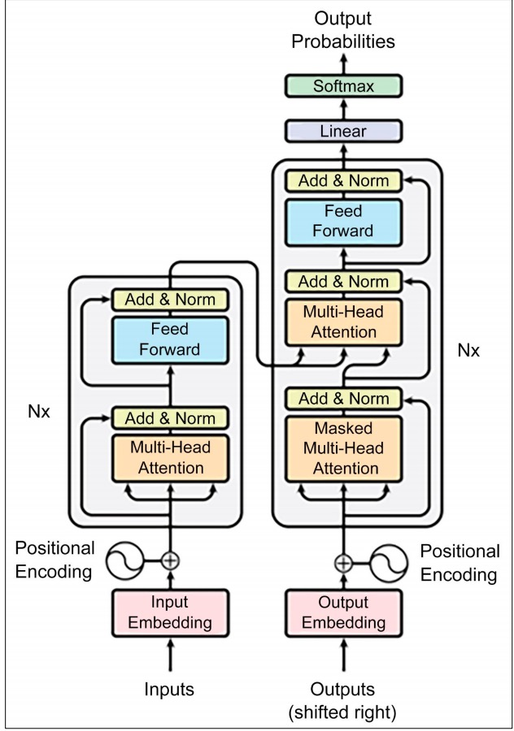

# 大语言模型

## 大规模语言模型介绍

> 大语言模型是以深度学习为基础，从大量未带标签的文本中学习众多模型参数。

> 深度学习是机器学习的分支，特点拥有多层神经网络（所以称为深度）。深度神经网络可以自动学习分层数据表示，从每一层的输入数据中提取更抽象的特征。

人工神经网络的基本构件是人工神经元，也称节点或单元。神经元被组织成了若干层，它们之间连接通过加权表示关系的强度。权重代表了模型训练过程被优化的参数。

非结构化文本数据作为模型输入的数据时需要两项基本活动：

1. 词元化：将一段文本分解为词元的较小单元的过程。目的是创建文本的结构化表示，便于机器学习模型处理。
2. 嵌入：每个词元会被转化为一个密集的数字向量。在语言模型训练中学到，捕捉词元之间的语义关系。数字表示法允许模型对词元进行数据运算，理解词元出现的语境。

### 反向传播

> 是深度学习中用于训练神经网络的一种算法。有两个阶段：前向传递通过网络计算输出；反向传递，网络通过比较预期结果与实际结果，尽量减小二者误差或损伤来进行学习，目的找到最佳权重集，达到新数据的精准预测。

### 贝叶斯定理

> 根据新证据来更新假设的概率。

$$
P(A|B)=\frac{P(B|A)P(A)}{P(B)}=\frac{P(B|A)P(A)}{\sum_{j=1}^n P(A_{j})P(B|A_{j})}
$$

- ‌**P(A|B)**‌：在B发生条件下A发生的概率（后验概率）
- ‌**P(B|A)**‌：在A发生条件下B发生的概率（似然）
- ‌**P(A)**‌：事件A的先验概率
- ‌**P(B)**‌：事件B的边缘概率（可通过全概率公式计算）

### 非线性激活函数

> 用于对神经网络的输出进行归一化处理。比如Softmax函数

### 模型训练步骤

1. 数据收集
2. 数据预处理：对数据进行清洗、过滤和格式化的过程。包括去除重复数据、噪声或敏感信息。
3. 模型架构：选择神经网络类型（如transformer）、结构（如仅解码器等）、层数和规模、注意力机制、激活函数等。
4. 模型初始化：为大语言模型的权重和偏置项分配初始值的过程。
5. 模型预训练：向模型输入成批数据并计算**损失函数**来更新权重和偏置项的过程。通过**优化算法**（如随机梯度下降算法）将损失最小化，该算法通过反向传播机制尽可能的减少权重和偏置项损失。
6. 微调：基础模型通过一个由（提示、理想响应）元组组成的数据集进行监督训练。输出称为监督微调（SFT）模型
7. 基于人类反馈的强化学习（RLHF）：奖励模型（结合人类偏好训练的另一个模型），反复优化监督微调模型

### 模型评估

* 通用语言理解评估（GLUE）和超级通用语言理解评估（SuperGLUE）：用户衡量大语言模型在各种语言的理解任务上的性能。GLUE得分越高，代表在不通任务领域中的泛化能力越强。
* 大规模多任务语言理解（MMLU）：使用零样本或少量样本测量语言模型所学到的知识
* HellaSwag：根据语言模型在给定语境中生成合理且符合常识的连续语句能力的评估
* TruthfulQA：评估模型生成问题回答时的准确性。
* AI2推理挑战（ARC）：衡量模型的推理能力，促进可执行复杂自然语言理解任务的模型开发

### 模型选择考量

* **性能与能力**：这是最核心的考量。不同的模型擅长的任务不同，有的长于逻辑推理和代码生成，有的则在创意写作或多语言翻译上更胜一筹。您可以参考一些公开的基准测试排行榜（如 LMSys Chatbot ArenaLeaderboard）来评估模型的综合能力。
* **成本**：对于闭源模型，成本主要体现在 API 调用费用，通常按 Token 数量计费。对于开源模型，成本则体现在本地部署所需的硬件（GPU、内存）和运维上。
* **速度（延迟）**：对于需要实时交互的智能体（如客服、游戏 NPC），模型的响应速度至关重要。
* **上下文窗口**：模型能一次性处理的 Token 数量上限。
* **部署方式**：使用 API 的方式最简单便捷，但数据需要发送给第三方，且受限于服务商的条款。本地部署则能确保数据隐私和最高程度的自主可控，但对技术和硬件要求更高。
* **生态与工具链**：一个模型的流行程度也决定了其周边生态的成熟度。包括社区支持、教程、预训练模型、微调工具和兼容的开发框架
* **可微调性与定制化**：一些模型提供了便捷的微调接口和工具，允许开发者使用自己的数据集对模型进行定制化训练
* **安全性与伦理**：考虑其在偏见、毒性、幻觉等方面的表现

### 缩放法则

它揭示了模型性能与模型参数量、训练数据量以及计算资源之间存在着可预测的幂律关系。

**能力涌现：**是指当模型规模达到一定阈值后，会突然展现出在小规模模型中完全不存在或表现不佳的全新能力。例如，链式思考 (Chain-of-Thought) 、指令遵循 (InstructionFollowing) 、多步推理、代码生成等能力，都是在模型参数量达到数百亿甚至千亿级别后才显著出现的。

### 模型幻觉

#### 阐述

大语言模型生成的内容与客观事实、用户输入或上下文信息相矛盾，或者生成了不存在的事实、实体或事件。

1. **事实性幻觉(Factual Hallucinations)** ： 模型生成与现实世界事实不符的信息。
2. **忠实性幻觉(Faithfulness Hallucinations)** ： 在文本摘要、翻译等任务中，生成的内容未能忠实地反映源文本的含义。
3. **内在幻觉(Intrinsic Hallucinations)** ： 模型生成的内容与输入信息直接矛盾。

#### 缓解幻觉的方法

1. **数据层面**： 通过高质量数据清洗、引入事实性知识以及强化学习与人类反馈 (RLHF) 等方式，从源头减少幻觉。
2. **模型层面**： 探索新的模型架构，或让模型能够表达其对生成内容的不确定性。
3.  **推理与生成层面**：
   1. **检索增强生成** **(Retrieval-Augmented Generation, RAG)** ： 这是目前缓解幻觉的有效方法之一。RAG 系统通过在生成之前从外部知识库（如文档数据库、网页）中检索相关信息，然后将检索到的信息作为上下文，引导模型生成基于事实的回答。
   2. **多步推理与验证**： 引导模型进行多步推理，并在每一步进行自我检查或外部验证。
   3. **引入外部工具**： 允许模型调用外部工具（如搜索引擎、计算器、代码解释器）来获取实时信息或进行精确计算

## Transformer

### 早期实验

> 梯度是一种度量模型内部参数（权重）微调后性能提高的指标。

1. 循环神经网络（RNN）：具有递归连接，允许信息跨时间步长持续存在，但存在梯度消失或爆炸的问题。循环神经网络会根据损失函数的梯度调整权重，以减少预测结果与实际目标之间的差异。训练中梯度变得极小或极大就会出现问题。在捕捉长距离依赖性存在局限。
2. 长短期记忆（LSTM）：可解决梯度消失的问题，引入门控机制，在更长的序列中保存重要信息。

### 架构

* 输入嵌入：词元分析器输入文本的向量表示
* 位置编码：提供了输入序列中有关单词的位置，使模型能够理解词元的顺序
* 多头注意力层：对输入数据的不同部分进行并行操作，从而产生多个表征，从多个角度聚合信息。
* 加法和归一化层：将层的输出添加到原始输入中，应用层进行归一化来稳定和加速训练过程。有助于缓解梯度问题，提高序列数据性能。
* 前馈层：使用非线性函数，将注意力层的归一化输出转换为适合的输出表示形式。
* 输出嵌入（右移）：解码器在目标序列右移一个位置。在每个位置上，模型都会尝试预测原始目标序列中的当前分析词元之后的词元。自回归解码
* 线性和softmax层：分别对输出向量进行线性和非线性变换。非线性变换将输出向量转为概率分布，与一组候选词相对应。



#### Encoder-Decoder 整体结构

1. **编码器** **(Encoder)** ：任务是“**理解**”输入的整个句子。
2. **解码器** **(Decoder)** ：任务是“**生成**”目标句子。

#### 从自注意力到多头注意力

允许模型在处理序列中的每一个词时，都能兼顾句子中的所有其他词，并为这些词分配不同的“注意力权重”。

* **查询** **(Query, Q)**：代表当前词元，它正在主动地“查询”其他词元以获取信息。
* **键** **(Key, K)**：代表句子中可被查询的词元“标签”或“索引”。 
* **值** **(Value, V)**：代表词元本身所携带的“内容”或“信息”

#### 前馈神经网络

**逐位置前馈网络**(Position-wise Feed-ForwardNetwork, FFN) 。如果说注意力层的作用是从整个序列中“动态地聚合”相关信息，那么前馈网络的作用从这些聚合后的信息中提取更高阶的特征

#### 残差连接与层归一化

* **残差连接** **(Add)**：该操作将子模块的输入 x 直接加到该子模块的输出 Sublayer(x) 上。这一结构解决了深度神经网络中的**梯度消失** **(Vanishing Gradients)** 问题。
* **层归一化** **(Norm)**：该操作对单个样本的所有特征进行归一化，使其均值为0，方差为1。这解决了模型训练过程中的**内部协变量偏移** **(Internal Covariate Shift)** 问题，使每一层的输入分布保持稳定，从而加速模型收敛并提高训练的稳定性。

### Decoder-Only 架构

完全抛弃了编码器，只保留了解码器部分。被称为**自回归**，只关注预测下一个最有可能出现的词。

**掩码自注意力** :保证在预测第 t 个词时，不去“偷看”第 t+1 个词的答案。在进行 Softmax 归一化之前，模型会应用一个“掩码”。这个掩码会将所有位于当前位置之后（即目前尚未观测到）的词元对应的分数，替换为一个非常大的负数。当这个带有负无穷分数的矩阵经过 Softmax 函数时，这些位置的概率就会变为 0。确保了预测的公平性和逻辑的连贯性。

## 大语言模型交互

### 提示工程

#### 模型采样参数

调整模型对 “概率分布” 的采样策略，让输出匹配具体场景需求，配置合适的参数可以提升Agent在特定场景的性能。

1. Temperature：温度是控制模型输出 “随机性” 与 “确定性” 的关键参数。
2. Top-k：将所有 token 按概率从高到低排序，取排名前 k 个的 token 组成 “候选集”，随后对筛选出的 k 个token 的概率进行 “归一化”
3. Top-p：将所有 token 按概率从高到低排序，从排序后的第一个 token 开始，逐步累加概率，直到累积和首次达到或超过阈值 p，此时累加过程中包含的所有 token 组成 “核集合”，最后对核集合进行归一化

#### 零样本、单样本与少样本提示

* **零样本提示** **(Zero-shot Prompting)** 这指的是我们不给模型任何示例，直接让它根据指令完成任务。这得益于模型在海量数据上预训练后获得的强大泛化能力。
* **单样本提示** **(One-shot Prompting)** 我们给模型提供一个完整的示例，向它展示任务的格式和期望的输出风格。
* **少样本提示** **(Few-shot Prompting)** 我们提供多个示例，这能让模型更准确地理解任务的细节、边界和细微差别，从而获得更好的性能。

#### 指令调优

是一种微调技术，它使用大量“指令-回答”格式的数据对预训练模型进行进一步的训练。

#### 基础提示技巧

* **角色扮演** **(Role-playing)** 通过赋予模型一个特定的角色，我们可以引导它的回答风格、语气和知识范围，使其输出更符合特定场景的需求
* **上下文示例** **(In-context Example)** 这与少样本提示的思想一致，通过在提示中提供清晰的输入输出示例，来“教会”模型如何处理我们的请求，尤其是在处理复杂格式或特定风格的任务时非常有效。

#### 思维链

提示中加入一句简单的引导语，如“请逐步思考”或“Let's think step by step”。 通过显式地展示其推理过程，模型不仅更容易得出正确的答案，也让它的回答变得更可信、更易于我们检查和纠正。


### 文本分词

**子词分词** **(Subword Tokenization)** 算法。它的核心思想是：将常见的词（如 "agent"）保留为完整的词元，同时将不常见的词（如 "Tokenization"）拆分成多个有意义的子词片段（如 "Token" 和 "ization"）。这样既控制了词表的大小，又能让模型通过组合子词来理解和生成新词。

#### 分词算法

1. **字节对编码 (Byte-Pair Encoding, BPE)**:
   1.  **初始化**：将词表初始化为所有在语料库中出现过的基本字符。
   2. **迭代合并**：在语料库上，统计所有相邻词元对的出现频率，找到频率最高的一对，将它们合并成一个新的词元，并加入词表。
   3. **重复**：重复第 2 步，直到词表大小达到预设的阈值
2. **WordPiece**：Google BERT 模型采用的算法。它与 BPE 非常相似，但合并词元的标准不是“最高频率”，而是“能最大化提升语料库的语言模型概率”。
3. **SentencePiece**：Google 开源的一款分词工具[8]，Llama 系列模型采用了此算法。它最大的特点是，将空格也视作一个普通字符（通常用下划线 _ 表示）。这使得分词和解码过程完全可逆，且不依赖于特定的语言（例如，它不需要知道中文不使用空格分词）。

#### 分词的目的

* **上下文窗口限制**：同样一段话，在不同语言（如中英文）或不同分词器下，Token 数量可能相差巨大。精确管理输入长度、避免超出上下文限制是构建长时记忆智能体的基础。
* **API** **成本**：大多数模型 API 都是按 Token 数量计费的。了解你的文本会被如何分词，是预估和控制智能体运行成本的关键一步。
* **模型表现的异常**：有时模型的奇怪表现根源在于分词。

#  Agent概述

## 发展历程

### 符合主义

智能源于对符号的逻辑操作，执行规则的逻辑推理机

**优势：**在于透明和可解释。由于推理步骤明确，其决策过程可以被完整追溯。

**问题：**常识知识与知识的获取瓶颈，以及框架问题与系统的脆弱性。系统看似智能的表现，完全依赖于设计者预先编码的规则。然

而，面对真实世界语言的无限可能性，这种穷举式的方法注定不可扩展。

### 联结主义

解决感知问题，核心思想包括：

1. 知识的分布式表示：知识并非以明确的符号或规则形式存储在某个知识库中，而是以连接权重的形式，分布式

   地存储在大量简单的处理单元（即人工神经元）的连接之间。

2. 简单的处理单元：每个神经元只执行非常简单的计算，如接收来自其他神经元的加权输入，通过一个激活函数

   进行处理，然后将结果输出给下一个神经元。

3. 通过学习调整权重：系统通过接触大量样本，根据某种学习算法（如反向传播算法）自动、迭代地调整神经元之间的连接权重，从而使得整个网络的输出逐渐接近期望的目标

### 强化学习

解决序贯决策问题，核心要素包括：

1. 智能体：学习者和决策者。
2. 环境：智能体外部的一切，是智能体与之交互的对象。
3. 状态：对环境在某一时刻的特定描述，是智能体做出决策的依据。
4. 行动：智能体根据当前状态所能采取的操作。
5. 奖励：环境在智能体执行一个行动后，反馈给智能体的一个标量信号，用于评价该行动在特定状态下的好坏。

### 预训练

解决模型知识面狭窄，核心思想包括：

1. 预训练阶段：首先在一个包含互联网级别海量文本数据的通用语料库上，通过**自监督学习**的方式训练一个超大规模的神经网络模型。这个阶段的目标不是完成任何特定任务，而是学习语言本身内在的规律、语法结构、事实知识以及上下文逻辑。
2. 微调阶段：完成预训练后，这个模型就已经学习到了和数据集有关的丰富知识。之后，针对特定的下游任务，只需使用少量该任务的标注数据对模型进行微调，即可让模型适应对应任务

#### 涌现能力

1. 上下文学习：无需调整模型权重，仅在输入中提供几个示例甚至零个示例，模型就能理解并完成新的任务。
2. 思维链推理：通过引导模型在回答复杂问题前，先输出一步步的推理过程，可以显著提升其在逻辑、算术和常识推理任务上的准确性。

## Agent的技术框架结构与关键模块 

智能体架构包含：

1. **感知模块**：接收环境传递的外部信息

2. **决策模块**：
   1. 规划与分解：智能体基于当前的观察和其内部记忆，更新对任务和环境的理解，并制定或调整一个行动计划。
   2. 推理与决策：根据当前计划，智能体从其可用的工具库中，选择最适合执行下一步骤的工具，并确定调用该工具所需的具体参数

3. **执行模块**：LLM生成的工具调用

   指令被发送到执行模块。该模块解析指令，从工具箱中选择并调用合适的工具来与环境交互或执行任务。

4. **反馈机制**：行动会改变环境的状态，并产生结果。

Workflow 和 Agent 的差异：**Workflow** **是让** **AI** **按部就班地执行指令，而** **Agent** **则是赋予** **AI** **自由度去自主达成目标。**

### 上下文管理与记忆模块

1. 短期记忆：存储在内存缓存中，会在本次会话结束后情况
2. 长期记忆：利用数据库支持持久化存储，智能体在未来会话中查询历史数据

### 向量数据库语义检索中的作用

#### 设计与应用关键点

1. 高效存储与检索：支持大规模数据的高效存储与检索。常用向量数据库包括`FAISS`和`Milvus`，他们能快速计算向量之间的相似度，并支持分布式部署。
2. 数据更新与维护：可以定期更新数据
3. 查询优化与缓存：可以查询缓存和索引优化计算，通常优化包括构建向量索引和提前计算相似度
4. 与大语言模型的协同：与大语言模型结合。模型负责生成向量表示，数据库负责高效存储和检索。

### 常用框架和开发者平台

#### ReAct

多步推理框架，将决策过程与任务执行融合在一起。在多问题时，可以根据推理机制判断问题的优先级，决定任务的执行顺序。不仅能够根据预设的规则进行任务规划，还可以通过不断学习和反馈优化自身决策过程。

#### Hugging Face

1. 模型库的开放性和多样性
2. 模型微调与部署的便捷性
3. 集成工具与API支持
4. 社区与开源支持

#### LangChain

多步推理和复杂任务自动化的开源框架，专注于将语言模型与多种工具集成起来。将大语言模型作为基础组件，通过链式结构实现任务的分解与执行。支持API、数据库和外部知识库无缝集成，使智能体可以高效处理复杂任务流。

优势还体现在灵活的任务调度能力。可以根据任务的复杂程度和优先级，动态调整执行路径，确保关键任务得到及时处理。

# 智能体范式

## ReAct

核心思想是模仿人类解决问题的方式，将**推理(Reasoning)** 与**行动 (Acting)** 显式地结合起来，形成一个**“思考-行动-观察”**的循环。这个过程形成了一个强大的协同效应：**推理使得行动更具目的性，而行动则为推理提供了事实依据。**

### 工具

大语言模型是智能体的大脑，**工具(Tools)** 是其与外部世界交互的“手和脚。

工具应包含以下三个核心要素：

1. **名称** **(Name)**： 一个简洁、唯一的标识符，供智能体在 Action 中调用。
2. **描述** **(Description)**： 一段清晰的自然语言描述，说明这个工具的用途。**这是整个机制中最关键的部分**，因为大语言模型会依赖这段描述来判断何时使用哪个工具。
3. **执行逻辑** **(Execution Logic)**： 真正执行任务的函数或方法。

实现：

1. 实现工具的核心逻辑：撰写工具执行的具体逻辑。
2. 构建通用的工具执行器：创建一个ToolExecutor类，统一管理器来注册和调度这些工具。
3. 测试：模拟工具调用，验证工具逻辑执行。

### 实现

#### 系统提示词设计

模板定义了智能体与LLM之间交互的规范：

* **角色定义**： “你是一个有能力调用外部工具的智能助手”，设定了LLM的角色。
* **工具清单 (`{tools}`)**： 告知LLM它有哪些可用的“手脚”。
* **格式规约 (`Thought`/`Action`)**： 这是最重要的部分，它强制LLM的输出具有结构性，使我们能通过代码精确解析其意图。
* **动态上下文 (`{question}`/`{history}`)**： 将用户的原始问题和不断累积的交互历史注入，让LLM基于完整的上下文进行决策。

#### 循环

ReActAgent核心是一个循环，它不断地“格式化提示词 -> 调用LLM -> 执行动作 -> 整合结果”，直到任务完成或达到最大步数限制。

#### 输出解析器的实现

LLM 返回的是纯文本，我们需要从中精确地提取出 Thought 和 Action 。

#### 工具调用与执行

首先检查是否为 Finish 指令，如果是，则流程结束。否则，通过tool_executor获取对应的工具函数并执行，得到observation 。

#### 观测结果的整合

此步是形成闭环的关键，将 Action 本身和工具执行后的 Observation 添加回历史记录中，为下一轮循环提供新的上下文。

### 分析

#### 特点

1. **高可解释性**：ReAct 最大的优点之一就是透明。通过 `Thought` 链，我们可以清晰地看到智能体每一步的“心路历程”——它为什么会选择这个工具，下一步又打算做什么。这对于理解、信任和调试智能体的行为至关重要。
2. **动态规划与纠错能力**：与一次性生成完整计划的范式不同，ReAct 是“走一步，看一步”。它根据每一步从外部世界获得的 `Observation` 来动态调整后续的 `Thought` 和 `Action`。如果上一步的搜索结果不理想，它可以在下一步中修正搜索词，重新尝试。
3. **工具协同能力**：ReAct 范式天然地将大语言模型的推理能力与外部工具的执行能力结合起来。LLM 负责运筹帷幄（规划和推理），工具负责解决具体问题（搜索、计算），二者协同工作，突破了单一 LLM 在知识时效性、计算准确性等方面的固有局限。

#### 局限性

1. **对LLM自身能力的强依赖**：ReAct 流程的成功与否，高度依赖于底层 LLM 的综合能力。如果 LLM 的逻辑推理能力、指令遵循能力或格式化输出能力不足，就很容易在 `Thought` 环节产生错误的规划，或者在 `Action` 环节生成不符合格式的指令，导致整个流程中断。
2. **执行效率问题**：由于其循序渐进的特性，完成一个任务通常需要多次调用 LLM。每一次调用都伴随着网络延迟和计算成本。对于需要很多步骤的复杂任务，这种串行的“思考-行动”循环可能会导致较高的总耗时和费用。
3. **提示词的脆弱性**：整个机制的稳定运行建立在一个精心设计的提示词模板之上。模板中的任何微小变动，甚至是用词的差异，都可能影响 LLM 的行为。此外，并非所有模型都能持续稳定地遵循预设的格式，这增加了在实际应用中的不确定性。
4. **可能陷入局部最优**：步进式的决策模式意味着智能体缺乏一个全局的、长远的规划。它可能会因为眼前的 `Observation` 而选择一个看似正确但长远来看并非最优的路径，甚至在某些情况下陷入“原地打转”的循环中。

#### 调试技巧

- **检查完整的提示词**：在每次调用 LLM 之前，将最终格式化好的、包含所有历史记录的完整提示词打印出来。这是追溯 LLM 决策源头的最直接方式。
- **分析原始输出**：当输出解析失败时（例如，正则表达式没有匹配到 `Action`），务必将 LLM 返回的原始、未经处理的文本打印出来。这能帮助你判断是 LLM 没有遵循格式，还是你的解析逻辑有误。
- **验证工具的输入与输出**：检查智能体生成的 `tool_input` 是否是工具函数所期望的格式，同时也要确保工具返回的 `observation` 格式是智能体可以理解和处理的。
- **调整提示词中的示例 (Few-shot Prompting)**：如果模型频繁出错，可以在提示词中加入一两个完整的“Thought-Action-Observation”成功案例，通过示例来引导模型更好地遵循你的指令。
- **尝试不同的模型或参数**：更换一个能力更强的模型，或者调整 `temperature` 参数（通常设为0以保证输出的确定性），有时能直接解决问题。

## Plan-and-Solve

1. **规划阶段 (Planning Phase)**： 首先，智能体会接收用户的完整问题。它的第一个任务不是直接去解决问题或调用工具，而是**将问题分解，并制定出一个清晰、分步骤的行动计划**。这个计划本身就是一次大语言模型的调用产物。
2. **执行阶段 (Solving Phase)**： 在获得完整的计划后，智能体进入执行阶段。它会**严格按照计划中的步骤，逐一执行**。每一步的执行都可能是一次独立的 LLM 调用，或者是对上一步结果的加工处理，直到计划中的所有步骤都完成，最终得出答案。

## Reflection

### 核心思想

1. **执行 (Execution)**：首先，智能体使用我们熟悉的方法（如 ReAct 或 Plan-and-Solve）尝试完成任务，生成一个初步的解决方案或行动轨迹。这可以看作是“初稿”。
2. **反思 (Reflection)**：接着，智能体进入反思阶段。它会调用一个独立的、或者带有特殊提示词的大语言模型实例，来扮演一个“评审员”的角色。这个“评审员”会审视第一步生成的“初稿”，并从多个维度进行评估，例如：
   - **事实性错误**：是否存在与常识或已知事实相悖的内容？
   - **逻辑漏洞**：推理过程是否存在不连贯或矛盾之处？
   - **效率问题**：是否有更直接、更简洁的路径来完成任务？
   - **遗漏信息**：是否忽略了问题的某些关键约束或方面？ 根据评估，它会生成一段结构化的**反馈 (Feedback)**，指出具体的问题所在和改进建议。
3. **优化 (Refinement)**：最后，智能体将“初稿”和“反馈”作为新的上下文，再次调用大语言模型，要求它根据反馈内容对初稿进行修正，生成一个更完善的“修订稿”。

### 分析

#### 缺点

1. **模型调用开销增加**:这是最直接的成本。每进行一轮迭代，至少需要额外调用两次大语言模型（一次用于反思，一次用于优化）。如果迭代多轮，API 调用成本和计算资源消耗将成倍增加。
2. **任务延迟显著提高**:Reflection 是一个串行过程，每一轮的优化都必须等待上一轮的反思完成。这使得任务的总耗时显著延长，不适合对实时性要求高的场景。
3. **提示工程复杂度上升**:Reflection 的成功在很大程度上依赖于高质量、有针对性的提示词。为“执行”、“反思”、“优化”等不同阶段设计和调试有效的提示词，需要投入更多的开发精力。

#### 优点

1. **解决方案质量的跃迁**:它能将一个“合格”的初始方案，迭代优化成一个“优秀”的最终方案。这种从功能正确到性能高效、从逻辑粗糙到逻辑严谨的提升，在很多关键任务中是至关重要的。
2. **鲁棒性与可靠性增强**:通过内部的自我纠错循环，智能体能够发现并修复初始方案中可能存在的逻辑漏洞、事实性错误或边界情况处理不当等问题，从而大大提高了最终结果的可靠性。

# 智能体框架

## 意义

1. **提升代码复用与开发效率**
2. **实现核心组件的解耦与可扩展性**
   1. **模型层**：负责与大语言模型交互，可以轻松替换不同的模型
   2. **工具层** ：提供标准化的工具定义、注册和执行接口，添加新工具不会影响其他代码
   3. **记忆层**：处理短期和长期记忆，可以根据需求切换不同的记忆策略（如滑动窗口、摘要记忆）。
3.  **标准化复杂的状态管理**
4.  **简化可观测性与调试过程**

## AutoGen

AutoGen 的设计哲学根植于"以对话驱动协作"。它将多智能体系统抽象为一个由多个“可对话”智能体组成的群聊。

## AgentScope

AgentScope 的核心创新在于其**消息驱动架构**。在这个架构中，所有的智能体交互都被抽象为**消息**的发送和接收，而不是传统的函数调用

### 架构

**基础组件层** **(Foundational Components)**：为整个框架提供了核心的构建块。 `Message`组件定义了统一的消息格式，支持从简单的文本交互到复杂的多模态内容； `Memory `组件提供了短期和长期记忆管理； `Model API `层抽象了对不同大语言模型的调用；而 `Tool `组件则封装了智能体与外部世界交互的能力。

**智能体基础设施层** **(Agent-level Infrastructure)** ：提供了更高级的抽象。这一层不仅包含了各种预构建的智能体（如浏览器使用智能体、深度研究智能体），还实现了经典的 ReAct 范式，支持智能体钩子、并行工具调用、状态管理等高级特性同时支持异步执行与实时控制。

**多智能体协作层** **(Multi-Agent Cooperation)** ：是 AgentScope 的核心创新所在。 `MsgHub `作为消息中心，负责智能体间的消息路由和状态管理；而` Pipeline `系统则提供了灵活的工作流编排能力，支持顺序、并发等多种执行模式。这种设计使得开发者可以轻松构建复杂的多智能体协作场景

**开发与部署层** **(Deployment & Devvelopment)**：体现了 AgentScope 对工程化的重视。 AgentScope Runtime 提供了生产级的运行时环境，而 AgentScope Studio 则为开发者提供了完整的可视化开发工具链。

## CAMEL

核心概念：角色扮演(Role-Playing) 和 引导性提示 (Inception Prompting)。 引导性提示两个智能体根据角色设定对话完成任务。

引导性提示关键部分：明确自身角色、告知协作者角色、定义共同目标、设定行为约束和沟通协议

## LangGraph

LangGraph 将智能体的执行流程建模为一种**状态机（State Machine）**，并将其表示为**有向图（Directed Graph）**。

1. **全局状态**：整个图的执行过程都围绕一个共享的状态对象进行，状态通常被定义为一个Python 的 `TypedDict` ，它可以包含任何你需要追踪的信息，如对话历史、中间结果、迭代次数等。所有的节点都能读取和更新这个中心状态。
2. **节点**：每个节点都是一个接收当前状态作为输入、并返回一个更新后的状态作为输出的 Python函数。节点是执行具体工作的单元
3. **边**：定义了从一个节点到另一个节点的跳转逻辑。

# LangChain

## 组件与功能介绍

### 链式逻辑

> 设计思想：链式逻辑将复杂任务拆解为多个步骤，并按照特定顺序依次执行，提供系统灵活性和可扩展性

链条逻辑任务结构分为：

1. 顺序链：任务按固定顺序依次进行，每个步骤输出作为下一个步骤输入。
   
2. 分支链：根据条件判断执行不同路径的任务。

3. 循环链：处理重复性任务

任务链分解策略：

1. 单一职责原则
2. 逻辑耦合最小化
3. 任务优先级划分
4. 异步处理策略

### 数据流与上下文传递

LangChain支持上下文管理，通过在链条内存储和传递变量来保持任务状态。

### 集成LLM进行推理与生成

LangChain无缝集成了多个大语言模型，为智能体的推理和自然语言生成提供支持。

### 回调与实时监控功能

LangChain帮助开发者跟踪任务链的执行状态，出现异常时及时响应。回调机制可以在链条执行的每个步骤中记录关键数据，并基于这些数据优化。

同时还支持错误回滚与重试机制，可以根据预定义的规则回滚，或在一定时间内重试。

## 多步推理和任务自动化

### 决策链条与自动化触发

1. SequentialChain：顺序执行任务链
   ```python
   from langchain_community.chat_models import ChatOpenAI
   from langchain.prompts import PromptTemplate
   from langchain.chains import SequentialChain, LLMChain
   from langchain.callbacks import StdOutCallbackHandler
   
   # 初始化 GPT-4 模型
   llm = ChatOpenAI(model_name="gpt-4", temperature=0.7)
   # 创建提示模板
   template_1 = PromptTemplate(
       input_variables=["query"],
       template="请解析查询：{query}"
   )
   template_2 = PromptTemplate(
       input_variables=["parsed_result"],
       template="基于解析结果：{parsed_result}，生成响应。"
   )
   # 创建回调处理程序
   callback = StdOutCallbackHandler()
   # 将模板与 LLM 结合，创建 LLMChain
   chain_1 = LLMChain(llm=llm, prompt=template_1, output_key="parsed_result")
   chain_2 = LLMChain(llm=llm, prompt=template_2, output_key="final_response")
   # 创建顺序任务链
   sequential_chain = SequentialChain(
       chains=[chain_1, chain_2],  # 加入任务链
       input_variables=["query"],  # 初始输入变量
       output_variables=["final_response"],  # 最终输出变量
       callback=[callback]
       memory=True,  # 开启上下文记忆
       verbose=True
   )
   # 执行任务链并打印结果
   response = sequential_chain.run({"query": "如何训练机器学习模型？"})
   print(response)
   ```

2. RouterChain：路由任务链
   ```python
   from langchain.chains import RouterChain
   # 根据输入动态选择任务路径
   router_chain = RouterChain(
       conditions={"查询订单": order_query_chain, "查询物流": logistics_query_chain}
   )
   # 运行任务链
   router_chain.run({"query": "查询物流信息"})
   ```

3. WebhookChain：事件触发任务链
   ```python
   from langchain.chains import WebhookChain
   # 创建 Webhook 任务链
   webhook_chain = WebhookChain(webhook_url="https://example.com/webhook")
   # 定义任务逻辑
   def on_new_order(data):
       chain.run(data)
   # 注册事件回调
   webhook_chain.on_event(on_new_order)
   ```

4. BlockingScheduler：定时器
   ```python
   from apscheduler.schedulers.blocking import BlockingScheduler
   from langchain.chains import SequentialChain
   # 创建顺序任务链
   chain = SequentialChain(chains=[...])
   # 创建调度器并定义定时任务
   scheduler = BlockingScheduler()
   scheduler.add_job(lambda: chain.run({"query": "生成日报"}), 'cron', hour=8)
   # 启动调度器
   scheduler.start()
   ```

5. ConversationChain：对话任务链
   ```python
   from langchain.chains import ConversationChain
   from langchain.llms import OpenAI
   # 初始化语言模型
   llm = OpenAI(model_name="gpt-4")
   # 创建对话任务链
   conversation_chain = ConversationChain(llm=llm, verbose=True)
   # 用户输入触发任务链
   response = conversation_chain.predict(input="查询订单状态")
   print(response)
   ```

### 任务链的优化

1. 异步任务链：可以独立运行，不依赖其他模块输出。
   ```python
   from langchain.chains import AsyncSequentialChain
   # 异步任务链，市场数据与客户分析并行执行
   async_chain = AsyncSequentialChain(
       chains=[market_data_chain, client_analysis_chain],
       verbose=True
   )
   # 执行异步任务链
   await async_chain.run(input_data)
   ```

2. 缓存机制
   ```python
   from langchain.cache import InMemoryCache
   # 初始化缓存系统
   cache = InMemoryCache()
   # 使用缓存查询客户数据
   def get_client_preferences(client_id):
       if cache.get(client_id):
           return cache.get(client_id)
       preferences = query_client_preferences(client_id)  # 查询数据库
       cache.set(client_id, preferences)
       return preferences
   from langchain.chains import RouterChain
   # 根据客户类型动态选择任务路径
   router_chain = RouterChain(
       conditions={
           "短期投资": short_term_strategy_chain,
           "长期投资": long_term_strategy_chain,
       }
   )
   # 执行动态任务链
   router_chain.run({"client_type": "短期投资"})
   ```

3. 错误处理与自动重试
   ```python
   from langchain.chains import SequentialChain
   def safe_execute_module(module, retries=3):
       for attempt in range(retries):
           try:
               return module.run()
           except Exception as e:
               print(f"错误发生：{e}，重试次数：{attempt + 1}")
       raise Exception("任务执行失败")
   # 包装模块执行，确保发生错误时自动重试
   safe_execute_module(market_data_chain)
   ```

4. 实时监控与性能分析
   ```python
   from langchain.callbacks import StdOutCallbackHandler
   # 初始化回调处理程序
   callback = StdOutCallbackHandler()
   # 监控任务链执行
   chain = SequentialChain(
       chains=[market_data_chain, client_analysis_chain],
       callbacks=[callback],
       verbose=True
   )
   ```

## 集成外部数据源工具

> 利用python相关的工具库，可以集成到Agent中

### 数据库

1. 关系数据库的集成：可以连接关系数据库查询数据，作为数据的输入或输出。

2. 向量存储的集成：对于非结构化的数据，向量数据库可以利用向量间相似匹配快速检索相关信息。
   ```python
   from langchain.vectorstores import FAISS
   from langchain.embeddings import OpenAIEmbeddings
   # 初始化向量数据库
   vector_store = FAISS.load_local("path/to/index", OpenAIEmbeddings())
   # 根据查询内容检索相似文档
   results = vector_store.similarity_search("查询物流信息", k=5)
   ```

### API调用与外部系统集成

1. 支持RESTful API
2. GraphQL集成

### 文件和文档处理模块集成

1. PDF文件处理
   ```python
   from PyPDF2 import PdfReader
   # 读取 PDF 文件并提取文本
   def extract_text_from_pdf(file_path):
       reader = PdfReader(file_path)
       text = ""
       for page in reader.pages:
           text += page.extract_text()
       return text
   ```

2. Excel文件处理
   ```python
   import pandas as pd
   # 读取 Excel 文件并解析数据
   df = pd.read_excel("report.xlsx")
   summary = df.describe()
   ```

### 物联网与边缘设备的集成

1. 传感器数据集成
   ```python
   import paho.mqtt.client as mqtt
   # 初始化 MQTT 客户端并连接到 IoT 平台
   client = mqtt.Client()
   client.connect("broker.hivemq.com", 1883)
   # 订阅温度传感器数据
   def on_message(client, userdata, message):
       temperature = float(message.payload.decode())
       if temperature > 25:
           print("启动空调")
   client.on_message = on_message
   client.subscribe("home/temperature")
   client.loop_start()
   ```

## 构建记忆能力与对话

### 短期记忆与上下文管理

### 长期记忆设计

1. 将键值对通过json文件存储到本地，用于长期增删改查

2. 优化策略包括：上下文截断、重要信息标记和动态上下文管理
   ```python
   from langchain.memory import ConversationBufferMemory
   # 初始化上下文管理器，并限制上下文长度
   memory = ConversationBufferMemory(memory_key="chat_history", max_length=5)
   # 在对话链中使用上下文管理器
   conversation = ConversationChain(llm=llm, memory=memory)
   ```

# LlamaIndex

> 针对大规模数据进行快速查询和高效索引的框架

### 智能体知识库构建

非结构化数据处理：

1. 利用大语言模型解析文本并提取结构化信息，利用模版化的提示语，引导模型解析输出固定格式。

2. 非结构化数据存在**噪声**、**数据重复**、**格式不一致**，构建知识库前需要先进行数据清洗。可以利用`Pandas`等工具辅助清洗数据。

   
